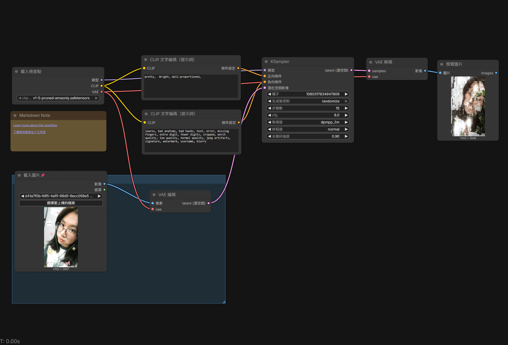
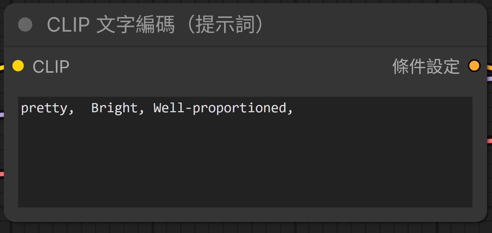
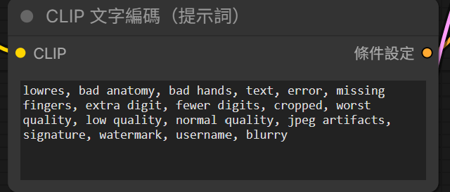

# 圖像生成練習
- 原圖片

- 生成圖片

- 流程圖

- 正反面提示詞

- 心得:
我覺得這個app就是...還蠻酷的，因為他是由很多節點去連結各個部份。
另外他也可以根據提示詞去更改照片的樣子，雖然有時候生成出來的圖片
不是很正常，老師也說有一些提示詞他可能不認識(因為模型比較舊)。但
整體來說還可以。不過我的電腦可能是因為沒有GPU的關係 ，所以再生成
一張圖片的時候，就需要比較多的時間，這一點還蠻困擾的。可能要解決
的話就是去找一台有的電腦。                                      